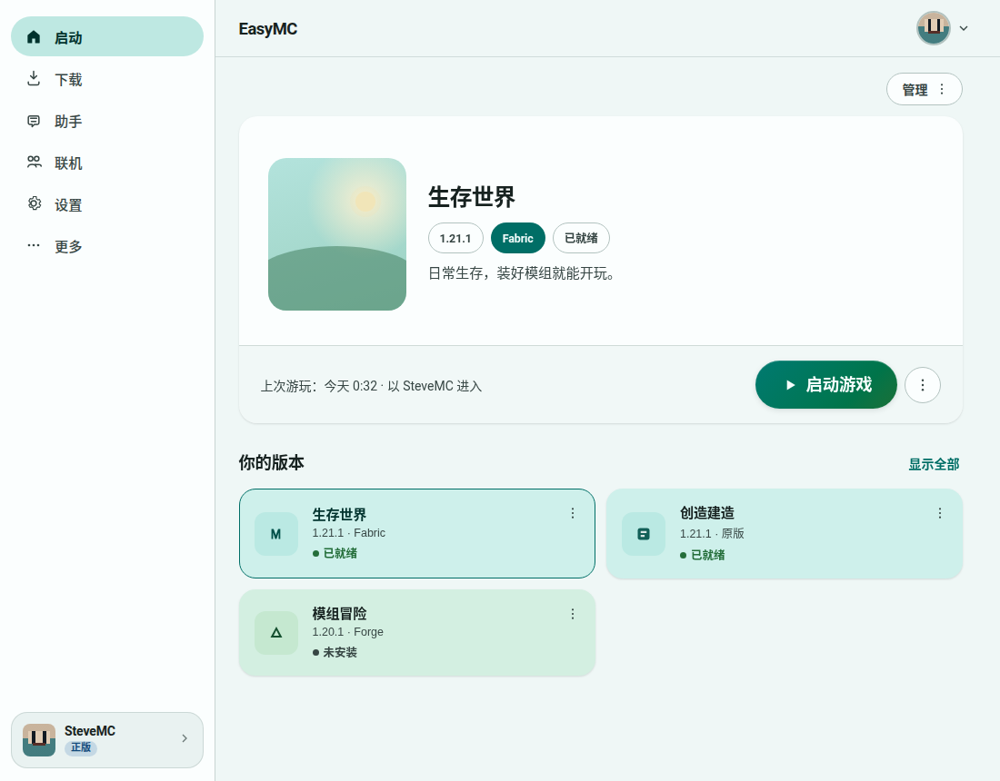
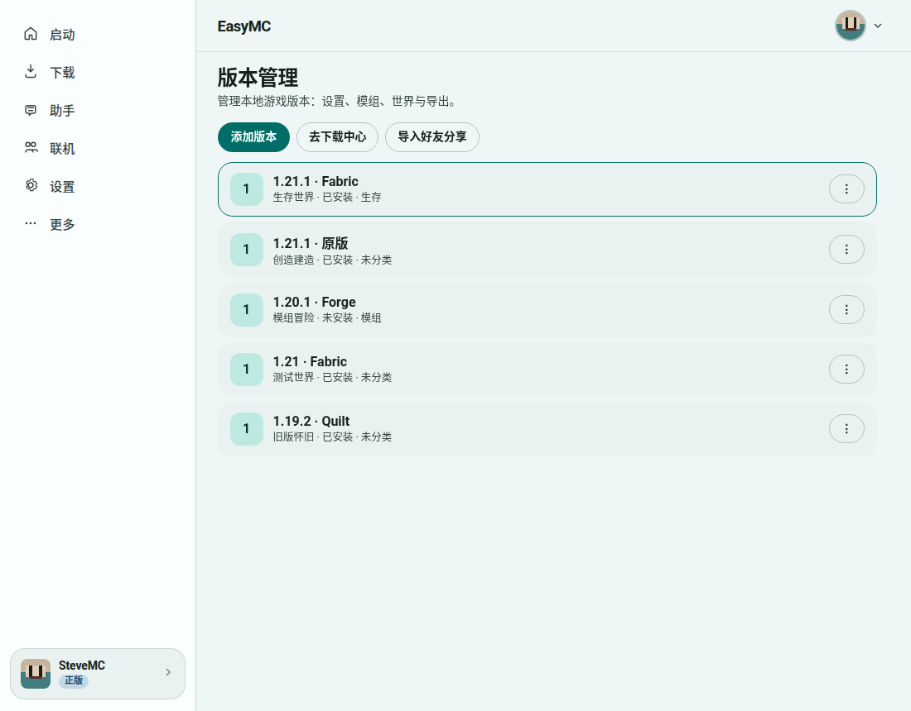
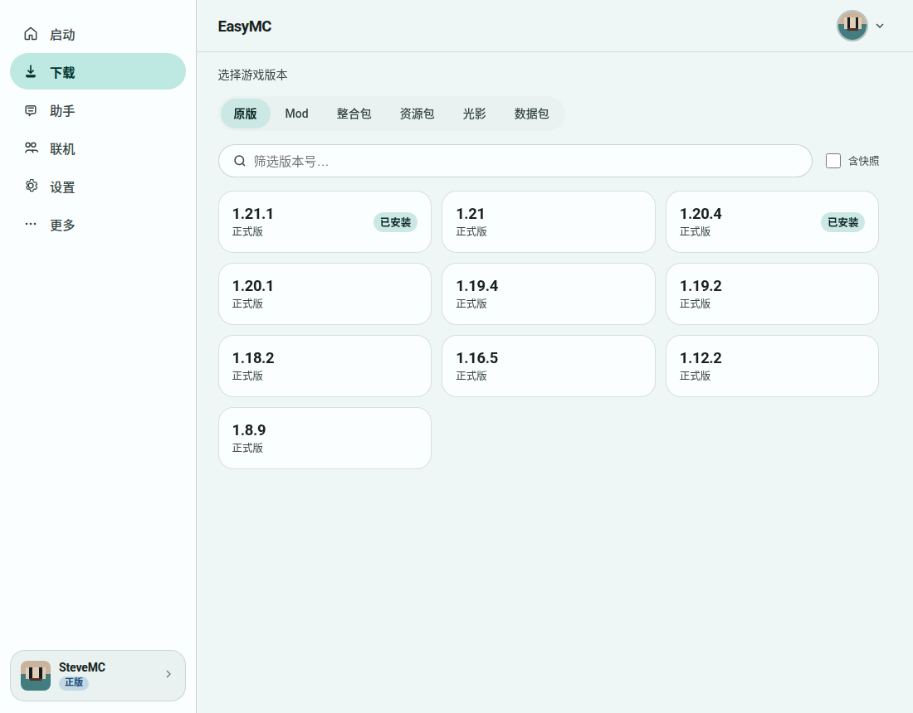
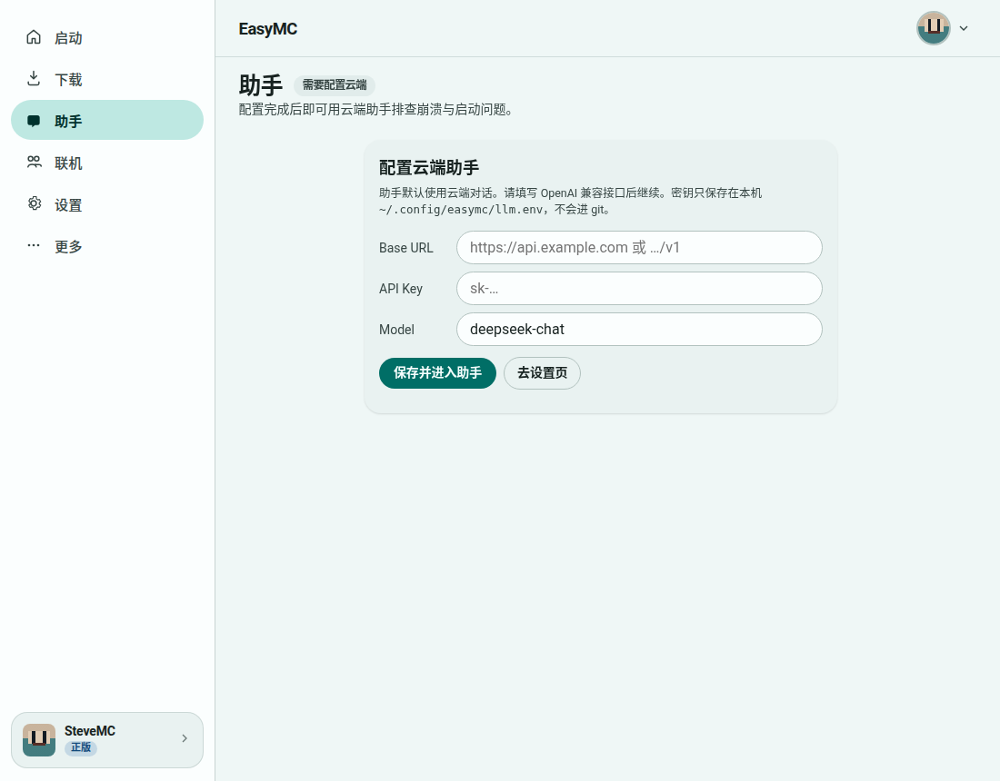

# EasyMC

<p align="center">
  
</p>

<p align="center">
  <strong>开源 · 桌面优先的 Minecraft Java Edition 启动器</strong><br />
  Open-source, desktop-first Minecraft Java Edition launcher<br />
  <sub>Tauri 2 · Lit · Vite · Rust</sub>
</p>

<p align="center">
  <a href="https://github.com/wiwcn/easymc/releases"></a>
  
  
</p>

<p align="center">
  <a href="https://github.com/wiwcn/easymc/releases/latest"><strong>下载 Windows 安装包</strong></a>
  ·
  <a href="#easymc-english">English</a>
</p>

---

**中文** | [English](#easymc-english)

EasyMC 帮普通玩家把「装版本 → 起游戏 → 装模组 → 换皮肤 → 排错」收成一条清晰路径。  
界面克制、信息够用；复杂能力留给需要时再展开。只做 **Java Edition**；桌面端（Windows / Linux / macOS）优先。

| | |
|---|---|
| **仓库** | https://github.com/wiwcn/easymc |
| **许可** | [LGPL-3.0-or-later](./LICENSE)（见 [COPYING](./COPYING) / [NOTICE](./NOTICE)） |
| **当前版本** | **0.2.0** |

## 界面预览

<p align="center">
  
  <br /><em>启动页 — 选版本，大按钮开玩</em>
</p>

<p align="center">
  
  <br /><em>实例 — 多版本并列管理</em>
</p>

<p align="center">
  
  <br /><em>下载 — 原版 / 模组 / 整合包</em>
</p>

<p align="center">
  
  <br /><em>助手 — 对话式排错与工具卡（0.2.0 起单栏精简）</em>
</p>

## 为什么选 EasyMC

- **装完就能玩**：原版与 Fabric / Quilt / Forge / NeoForge，系统 Java 检测与 Temurin 下载
- **模组不绕路**：Modrinth + CurseForge 搜索安装；库内启用 / 禁用 / 卸载；**批量更新**
- **皮肤衣柜**：3D 预览、本地上传、正版名 / LittleSkin；启动可套用当前皮肤
- **助手帮你看日志**：中文步骤摘要、折叠过程、工具确认；可选 OpenAI 兼容云端模型
- **便携与数据可控**：`portable.txt` 绿色目录；游玩时长、桌面快捷方式、实时启动控制台
- **开源可审计**：LGPL-3.0-or-later，桌面逻辑以本仓库为准

## 功能一览

### 启动与实例
- 多实例管理；大按钮启动；**快速进入**（世界 / 服务器 / Realms，1.20+）
- 原版安装（客户端、库、natives、资源；可选快速安装）
- 加载器安装走官方安装器路径
- **实时启动控制台**；游玩时长统计；可选桌面快捷方式

### 下载与模组
- 下载源：官方或 BMCLAPI（失败回退）
- Modrinth + CurseForge；`.mrpack` / CurseForge 清单整合包
- 实例内 **模组批量更新**

### 账户与衣柜
- 离线账户；微软 Device Code（需自备 `EASYMC_MSA_CLIENT_ID`）
- **衣柜**：skinview3d 预览与导入

### 助手
- 连接门闩（未配置 API 时引导填写）；单栏对话
- 步骤摘要完成即折叠；工具卡 / 提案确认
- 本地规则诊断 + 可选云端 LLM（密钥仅存本机）

### 其它
- 导出 / 导入分享包；mclo.gs 上传日志
- **便携模式**（设置或旁路标记文件）
- 主题：浅色 / 深色 + 自定义强调色
- 可选容器模式（Podman）；见 [`docs/CONTAINER-MODE.md`](./docs/CONTAINER-MODE.md)

## 快速开始（Windows）

1. 打开 [Releases](https://github.com/wiwcn/easymc/releases) → 下载 **`EasyMC_0.2.0_x64-setup.exe`**
2. 安装并运行（未代码签名时，SmartScreen 可能提示「仍要运行」）
3. 或使用便携包：**`easymc-app.exe`** 与同目录的 **`portable.txt`**，数据落在旁路 `data/`

Linux / macOS：当前以从源码构建为主；正式安装包以 Windows CI 为准。

## 从源码构建

```bash
pnpm install
pnpm tauri build
# 开发
pnpm tauri dev
```

环境：Node 22+、pnpm、Rust stable。更多 CLI：`cargo run -p easymc-cli -- --help`。

## 配置要点

| 项 | 说明 |
|---|---|
| 数据目录 | `EASYMC_DATA_DIR` → 便携标记旁路 `data/` → 平台默认 `EasyMC` |
| 助手 LLM | 设置 / 助手页填写 Base URL、密钥、模型；或环境变量 `EASYMC_LLM_*` |
| 微软登录 | `EASYMC_MSA_CLIENT_ID` |

## 仓库结构（简）

| 路径 | 内容 |
|---|---|
| `src/` | Lit 前端（页面、主题、组件） |
| `src-tauri/` | Tauri 壳与命令 |
| `crates/*` | 核心、元数据、模组、助手、启动、分享、容器、CLI |

## 已知缺口

- Android 姊妹项目另库；桌面才是完整启动路径
- 第三方皮肤站完整 Authlib / Nide8 登录仍在规划
- 未代码签名：Windows 首次运行可能被 SmartScreen 拦截

## 贡献与许可

Issue / PR 欢迎。许可为 [LGPL-3.0-or-later](./LICENSE)。产品设计见 [`DESIGN.md`](./DESIGN.md)。

---

## EasyMC (English)

**EasyMC** is an open-source, desktop-first **Minecraft Java Edition** launcher (Tauri 2 + Lit + Rust). Install versions, launch, manage mods, wardrobe skins, and troubleshoot with a calm Chinese-first Agent UI — without turning into a server ops console.

**License:** [LGPL-3.0-or-later](./LICENSE) · **Version:** 0.2.0 · **Repo:** https://github.com/wiwcn/easymc

### Screenshots

Same captures as above: [home](docs/screenshots/home.png) · [instances](docs/screenshots/instances.png) · [download](docs/screenshots/download.png) · [agent](docs/screenshots/agent.png)

### Highlights

- Multi-instance launch, Fabric / Quilt / Forge / NeoForge, Java detect + Temurin download, Quick Play
- Modrinth + CurseForge, modpacks, **batch mod updates**, live launch console, playtime, desktop shortcuts
- Skin **wardrobe** (skinview3d), portable/`portable.txt` data dir, theme + accent color
- **Agent**: config gate, single-column chat, foldable step abstracts, tool cards; optional OpenAI-compatible LLM (keys stay local)

### Install (Windows)

Download **`EasyMC_0.2.0_x64-setup.exe`** from [Releases](https://github.com/wiwcn/easymc/releases/latest). Portable: place `easymc-app.exe` next to `portable.txt`. Unsigned builds may trigger SmartScreen — choose “Run anyway”.

### Build

```bash
pnpm install && pnpm tauri build
```

### Links

- Releases: https://github.com/wiwcn/easymc/releases
- Design notes: [`DESIGN.md`](./DESIGN.md)
- Container mode: [`docs/CONTAINER-MODE.md`](./docs/CONTAINER-MODE.md)
